<p align="center">
  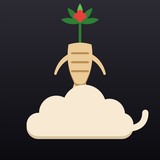
</p>

<h1 align="center">人蔘修煉</h1>

<p align="center">量一次體組成，就知道自己是築基還是金丹，還差幾公斤肌肉升下一期。<br>給有在重訓的人用的 iPhone app，男女都能用，不用註冊，資料只存在你的手機。</p>

<p align="center">
  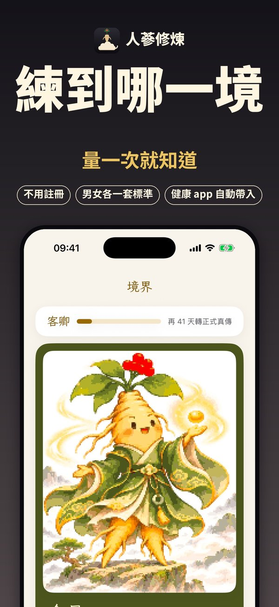
  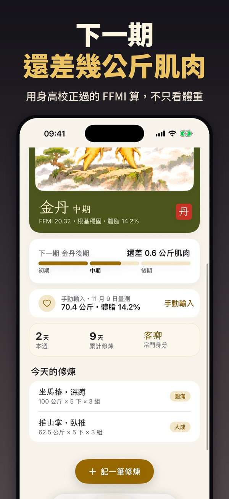
  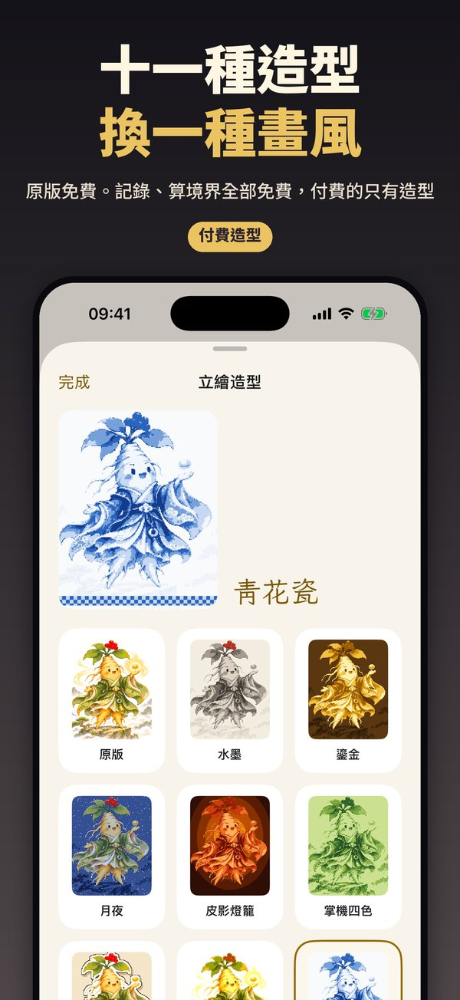
</p>

---

## 目錄

- [境界怎麼算](#境界怎麼算)
- [突破的時候會放慶祝](#突破的時候會放慶祝)
- [記修煉：十二門功法](#記修煉十二門功法)
- [健康 app、小工具與 Siri](#健康-app小工具與-siri)
- [資料：不用註冊，換手機帶得走](#資料不用註冊換手機帶得走)
- [付費的只有立繪造型](#付費的只有立繪造型)
- [隱私](#隱私)
- [給開發者](#給開發者)

---

## 境界怎麼算

練了三個月，鏡子裡看不出差別，體脂秤上的數字也說不出什麼，很多人就是這樣停掉的。人蔘修煉把體重和體脂率換算成 FFMI（用身高校正過的去脂體重指數），再對到修仙小說的七個境界：

煉氣、築基、金丹、元嬰、化神、大乘、渡劫，每個境界分初期、中期、後期。

男生女生各一套標準。女生用自己的換算，最後放到同一張境界表上，所以兩邊看到的境界意思一樣。

境界看 90 天內最近三次量測的平均，升上去就不會掉，體脂秤某一次量歪了不會影響。

體脂要在 20% 以下（女生 27%）境界才算數。超過也照樣算給你看，境界碑標「根基不穩」，進度條變灰，旁邊寫還差幾 % 就生效。剛開始練、體脂偏高的人一樣看得到自己在哪，只是突破紀錄和宗門的最高境界只採計體脂在門檻內的量測。

<p align="center">
  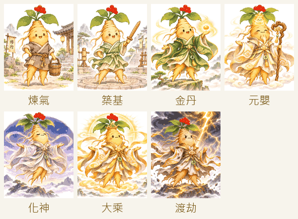
  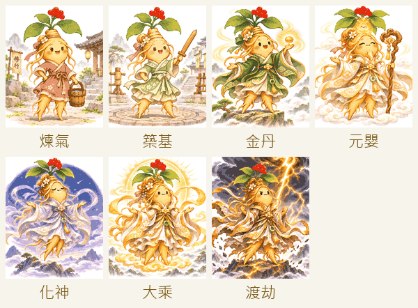
</p>

<p align="center">
  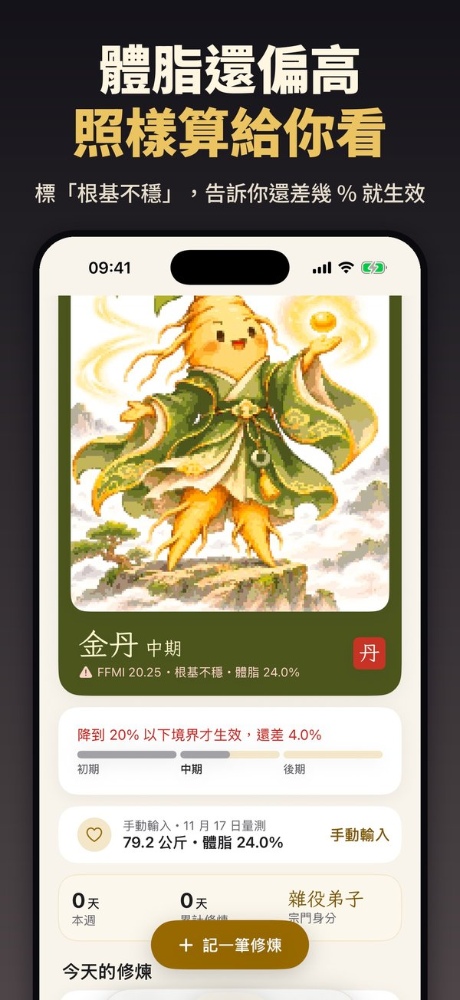
</p>

每個境界的立繪都是像素畫，在境界碑上會慢慢動：煉氣男掂水桶、築基男舉劍下劈、金丹男拋接金丹、渡劫男扛一道大雷。待機時身體只有慢慢呼吸，招牌動作一輪做一次。

境界之外還有宗門身分，看的是累計修煉天數加上曾經到過的最高境界：雜役弟子、外門弟子、內門弟子、真傳弟子、長老、太上長老。實力夠但天數不夠的是客卿，天數夠但境界還沒跟上的是執事。

## 突破的時候會放慶祝

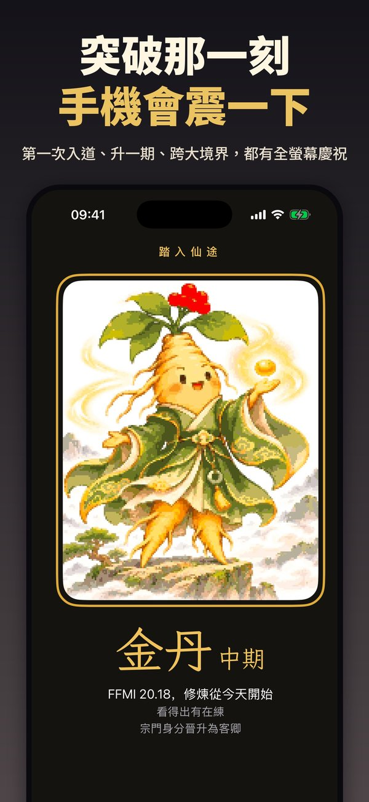

第一次入道、升一期、跨一個大境界、宗門晉升，都有全螢幕慶祝，手機會震一下。點一下關掉，或 4.5 秒後自己關。

記修煉也有。第一筆放「引氣入體」，還沒量過體重也會放。隔了 21 天以上回來再記一筆放「出關」，寫你累計修煉了幾天；回來還沒記的時候，境界頁最上面的宗門卡會寫「36 天修煉都還在」，練完一筆就換回下一步。

幾個防刷的規則：

- 補登以前日期的量測不放慶祝。
- 同一天量第二次會先問你要不要蓋掉第一筆，不會默默覆寫。
- 系統開了「減少動態效果」，慶祝就不噴粒子。

<br clear="right">

## 記修煉：十二門功法

<p align="center">
  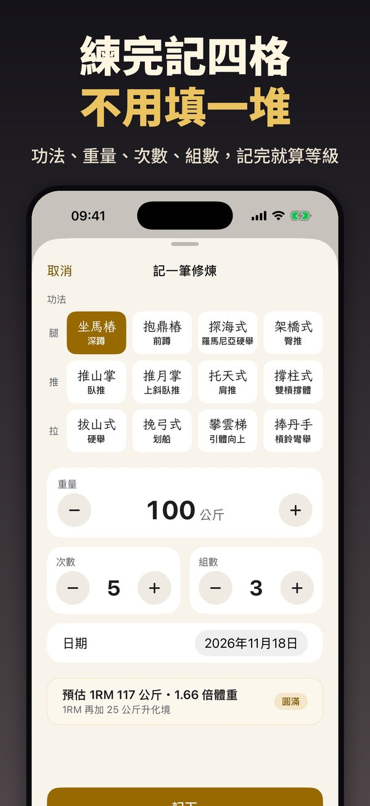
  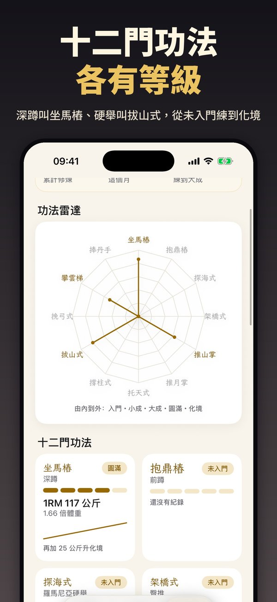
</p>

每筆只記四格：功法、重量、次數、組數，加一個日期。記一筆的表單會先帶上次那門功法的數字，功法格下面寫著上次是哪天、做多少。

十二門功法分腿、推、拉三排：

| | 功法 | 動作 |
|---|---|---|
| 腿 | 坐馬樁、抱鼎樁、探海式、架橋式 | 深蹲、前蹲、羅馬尼亞硬舉、臀推 |
| 推 | 推山掌、推月掌、托天式、撐柱式 | 臥推、上斜臥推、肩推、雙槓撐體 |
| 拉 | 拔山式、挽弓式、攀雲梯、捧丹手 | 硬舉、划船、引體向上、槓鈴彎舉 |

app 用你那組的重量和次數估 1RM（Epley 公式），再除以體重，對到五階門檻，從未入門往上是入門、小成、大成、圓滿、化境。分析頁有十二根軸的雷達圖，每門功法也有自己的 1RM 走勢線。

1RM 真的比以前最高的還重才放「功法精進」，沒量過體重也放（引體向上、雙槓撐體除外，這兩門要有體重才算得出 1RM）。只是體重掉了讓比例變好，等級照升，但不放煙火，減脂期才不會一直收到假的慶祝。

## 健康 app、小工具與 Siri

體脂秤的數字有同步到 iPhone 的健康 app 的話，打開人蔘修煉，體重和體脂率已經帶進來了，按一下就結算。沒有體脂秤也可以自己打。

- 讀：體重、體脂率、去脂體重、身高、生理性別。第一次打開問一次，不允許也能用，全部改手打。
- 寫：預設關。在設定打開「量測寫回健康 app」才會問寫入權限，而且只寫你親手輸入的數字，從健康 app 帶進來的、從檔案匯入的都不會寫回去。

不開 app 也看得到：

- 主畫面小工具有小、中兩種。小的顯示境界和這週練了幾天，中的再多一句還差幾公斤升下一期。這週還沒練就寫累計幾天。
- 鎖定畫面有一個圓形小工具，顯示這週練了幾天，這週還沒練也是寫累計。
- 對 Siri 說「用人蔘修煉記一下深蹲」，它會問你幾公斤、幾下，記好不用打開 app。也可以問「人蔘修煉我現在什麼境界」。
- 每月量測提醒預設是關的，打開之後每月一次，早上 8 點由手機自己發，通知上不寫你的數字。

## 資料：不用註冊，換手機帶得走

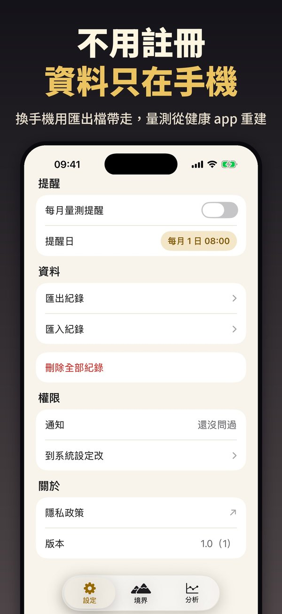

沒有帳號，沒有廣告，沒有分析工具。紀錄只存在這支手機。

換手機的時候，量測從健康 app 重建，修煉紀錄和身高用設定裡的「匯出紀錄」帶走。匯出是一個 JSON 檔，交給 iPhone 的分享選單，你自己決定存到哪。匯入時 app 會先檢查整個檔，告訴你會新增幾筆，你按了才寫進去，壞檔整個拒收，不會寫一半。

設定裡也可以一次刪掉全部紀錄。健康 app 裡的資料不受影響。

這個 app 不做 iCloud 同步。App Store 審核規範 5.1.3 不准把健康資料存在 iCloud，所以換手機靠健康 app 加匯出檔。

<br clear="right">

## 付費的只有立繪造型

記錄、算境界、健康 app、小工具、Siri 全部免費。要付錢的只有立繪造型。

<p align="center">
  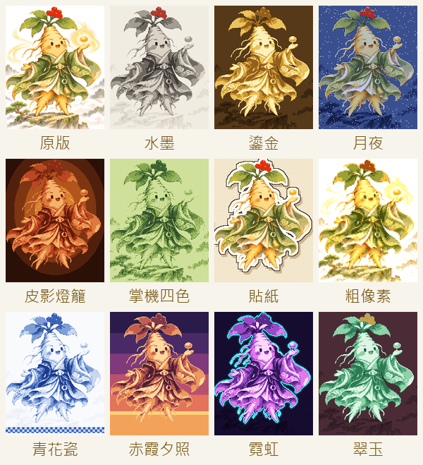
</p>

原版像素立繪免費，另外十一種造型可以換：水墨、鎏金、月夜、皮影燈籠、掌機四色、貼紙、粗像素、青花瓷、赤霞夕照、霓虹、翠玉。換了以後，境界碑和慶祝畫面的人蔘全部換成那一種，男女七個境界都有，每一種都有自己的待機動畫。

台灣價格是每種 NT$120，全套十一種 NT$480，買一次就是你的。換手機或重裝，到選造型頁按「恢復購買」就回來。

<p align="center">
  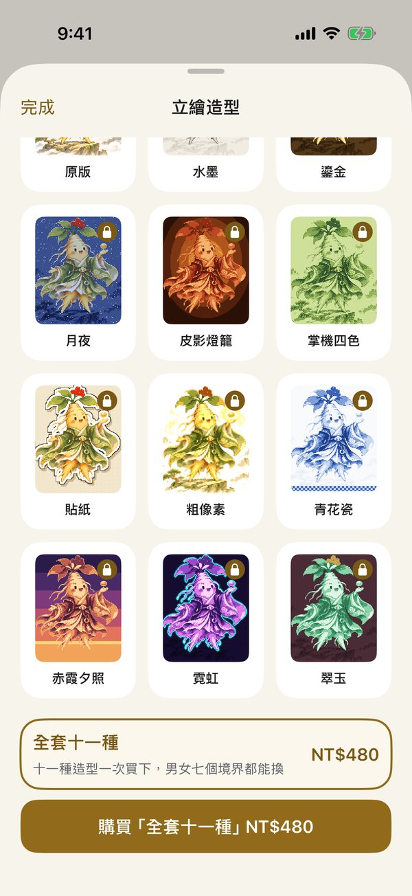
  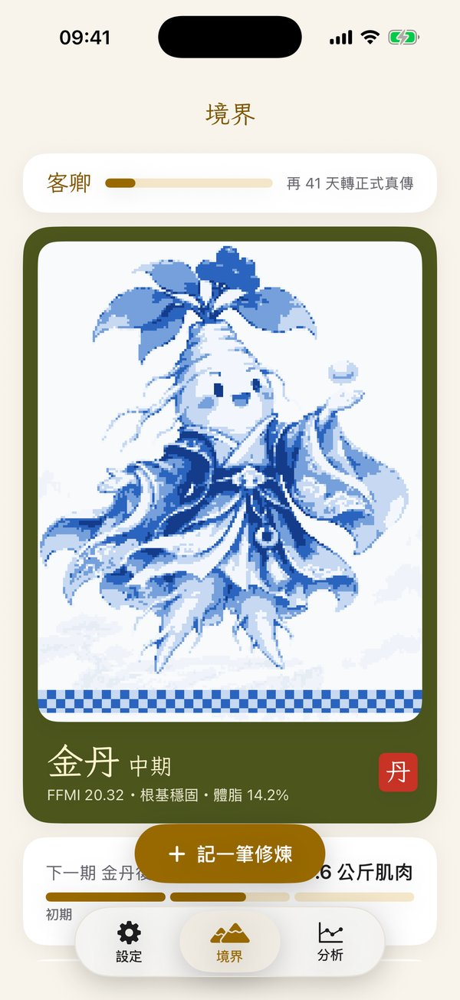
</p>

入口在設定頁的「立繪造型」。沒買的也能點來預覽，確定要買才付款。付款整個在 Apple 的付款視窗完成，app 拿不到你的卡號和 Apple ID。

## 隱私

人蔘修煉只跟 Apple 的 App Store 連線，用來讀造型的價格、確認你買過哪幾種、處理購買。除此之外不連網。你的體重、體脂率和修煉紀錄只存在你的 iPhone，這個 app 沒有伺服器，做 app 的人看不到你的任何資料，也就沒辦法幫你刪或幫你找回來，換手機前記得先匯出。

健康 app 的資料只用來算 FFMI 和境界，不拿去做廣告，也不交給任何人。

匯出的 JSON 檔沒有加密，裡面是你的身體數據，傳給誰、存在哪要自己保管。

這個 app 不量任何東西，也不是醫療工具。數字來自你的體脂秤或你自己輸入，體脂秤本身誤差不小，境界拿來看自己有沒有在進步就好。

完整的隱私政策在 https://domyweb.org/rencan/privacy ，有問題或要回報錯誤，到支援頁 https://domyweb.org/rencan/support 找聯絡方式。

---

## 給開發者

這一段寫給要讀程式、跑測試或接手開發的人。整個 app 是在 Windows 上寫的，手邊沒有 Mac，編譯、測試、簽章、上傳 TestFlight 全部交給 GitHub Actions。

### 技術組成

| 項目 | 用什麼 |
|---|---|
| 介面 | SwiftUI，最低 iOS 17，用 Xcode 26 編 |
| 資料 | SwiftData，只存本機 |
| 健康 app | HealthKit：讀五種、寫三種（寫入預設關） |
| 內購 | StoreKit 2，十二個非消耗性項目，沒有伺服器、沒有收據驗證服務 |
| 小工具 | WidgetKit：主畫面小、中，鎖定畫面圓形，跟主 app 用 App Group 共用一份快照 |
| Siri 與捷徑 | App Intents：記修煉、問境界 |
| 圖表 | Swift Charts（FFMI 走勢、1RM 走勢） |
| 規則引擎 | `RencanCore`，純 Swift 套件，只 import Foundation，Linux 上也能跑測試 |
| 字體 | 霞鶩文楷 TC（LXGW WenKai TC，開源授權，內嵌在 app 裡） |
| 第三方套件 | app 本體零第三方套件 |

所有公式與表格（境界門檻、功法門檻、宗門身分、FFMI、1RM、慶祝判定）都在 `RencanCore`。境界頁、分析頁、Siri、小工具全部呼叫它，沒有第二份算法。畫面只負責排版。

### 資料夾結構

```
ios/
  Rencan/                  主 app
    App/                   進入點、三頁左右滑（設定／境界／分析）、主題色與字體、UI 測試用的啟動參數
    Models/                SwiftData 模型：量測、修煉、使用者設定
    Services/              儲存、健康 app、內購、匯入匯出、通知、震動、小工具快照
    Views/                 Realm（境界頁）、Analysis（分析頁）、Gong（功法）、Log（記一筆與表單）、Settings、慶祝畫面
    Intents/               Siri 與捷徑
    Resources/             Assets（立繪、造型、動畫、顏色）、Fonts
  RencanCore/              規則引擎套件與它的單元測試（含網頁版真實資料算出的黃金答案）
  RencanUITests/           UI 測試：模擬器走流程並截圖，只在檢查線跑
  RencanWidget/            小工具 extension
  ci/                      CI 用的腳本與資料（描述檔、TestFlight 說明、內購商品、上架資料、商品頁截圖）
.github/workflows/         四支工作流，見下一節
docs/                      上架文稿、隱私政策、上架隱私填寫清單、驗收清單
.uiux/像素風立繪/          立繪與動畫的產生程式
.vibe/                     產品定稿、架構藍圖、安全標準等設計文件，tools/ 是本機用的小工具
index.html、img/、manifest.webmanifest
                           最早的網頁版（PWA），已停用；留著它的「匯出 JSON」鈕，讓舊紀錄能匯進 iOS 版
```

### CI：四支 GitHub Actions 工作流

| 工作流 | 什麼時候跑 | 做什麼 | 碰 secrets 嗎 |
|---|---|---|---|
| `ios-check.yml`（檢查線） | 推到 `work/**` 分支自動跑，也可手動 | Linux 跑 `RencanCore` 測試；macOS 跑 swift-format 與 SwiftLint（嚴格）、模擬器編譯、UI 測試並截圖 | 不碰。不簽章、不上傳 |
| `ios.yml`（出 TestFlight） | 推到 `main` 自動跑，也可手動 | 測試、lint、archive、手動簽章、上傳 App Store Connect，再等 Apple 處理完填 TestFlight 測試說明 | 用。憑證進暫時鑰匙圈，跑完不管成敗都刪 |
| `iap.yml`（內購商品） | 只能手動按 Run workflow，只准 `main` | 照 `ios/ci/iap_products.json` 在 App Store Connect 查、建或更新內購商品，傳審核截圖。模式 `check`／`create`／`screenshots`，預設只查 | 用 API 金鑰 |
| `asc.yml`（上架資料） | 只能手動按 Run workflow，只准 `main` | 查或填 App Store Connect 的版本資料。`check` 只查；`fill` 填文字、類別、分級、價格；`media` 傳商品頁截圖與送審錄影；`submit` 送審 | 用 API 金鑰 |

`iap.yml` 和 `asc.yml` 在工作流裡寫死 `if: github.ref == 'refs/heads/main'`，從別的分支按會整個跳過。原因是內購的產品 ID 建了不能改、刪了不能再用，分支上沒審過的資料不能碰正式後台。

平常的節奏是：在 `work/xxx` 分支上改，推上去讓檢查線跑，綠了再併進 `main`，`ios.yml` 出一版 TestFlight。這樣中途反覆修編譯錯誤時，不會每推一次就多一個 TestFlight 版本。

憑證、API 金鑰要放哪幾個 GitHub Secrets、怎麼在 Windows 上用 openssl 做出發佈憑證，寫在 [`ios/ci/README.md`](ios/ci/README.md)。repo 裡永遠不放 `.p12`、`.p8`、`.key` 這類檔案，`.gitignore` 會擋。

### 跑測試

規則引擎（Swift 5.10 以上，Linux 也行）：

```bash
swift test --package-path ios/RencanCore
```

檢查線用的是 `swift:6.0-noble` 容器，本機有 Docker 可以照跑：

```bash
docker run --rm -v "$PWD":/src -w /src swift:6.0-noble swift test --package-path ios/RencanCore
```

UI 測試要 macOS 加 Xcode 26，指令跟檢查線一樣：

```bash
cd ios
xcodebuild test -project Rencan.xcodeproj -scheme Rencan \
  -destination "platform=iOS Simulator,name=<你的模擬器>" \
  CODE_SIGN_IDENTITY=- CODE_SIGNING_REQUIRED=NO
```

UI 測試靠幾個只有 Debug 版才認的啟動參數塞示範資料，例如 `-rencanUITest`、`-rencanSeed demo`（有量測和修煉的畫面）、`-rencanSeed unstable`（根基不穩）、`-rencanSeed female`。TestFlight 和上架版一律不認。

### 沒有 Mac 怎麼開發

1. 在 Windows 寫 Swift。推之前可以先跑 `node .vibe/tools/dev/swift_check.js ios/Rencan` 粗篩行長、括號、常見 lint 紅燈，真正的檢查還是在 GitHub。
2. 推到 `work/xxx` 分支，等檢查線跑完。
3. 到那次執行的 artifact 下載 `rencan-ui-screenshots`（UI 測試每一步的截圖）和 `rencan-ui-log`（編譯與測試紀錄），看畫面對不對。
4. 要親手點一遍的話，下載 `rencan-sim-app`（模擬器版），丟到 Limrun 的雲端 iPhone 模擬器：`node .vibe/tools/limrun_walk.mjs <rencan-sim.zip> <截圖資料夾>`。要先設 `LIM_API_KEY`。Limrun 照分鐘計費，腳本跑完一定會把機器刪掉。
5. 綠了併進 `main`，`ios.yml` 出 TestFlight，裝到手機上驗震動、Siri、真體脂秤這些模擬器驗不到的東西。

### 立繪與動畫怎麼來的

立繪先有一份水彩原圖（男 `r0`–`r6`、女 `gr0`–`gr6`，煉氣到渡劫），之後全部用 `.uiux/像素風立繪/` 裡的 Python 程式產生（要 Pillow、NumPy；去背另外要 OpenCV、rembg，換色要 SciPy）：

1. `pixelate2.py`：十四張水彩圖轉成 168×210 的像素圖，十四張共用一份 72 色的色盤，另外做一張閉眼的。
2. `造型風格/ai_matte.py`（取代較早的 `matte.py`）：在水彩原圖上用 AI 去背，切出角色範圍的遮罩，動畫才能把背景、角色、特效分三層疊。
3. `animate.py`（搭配 `rig.py` 的小骨架）：每張做一條待機動畫，12×8 的格子圖共 96 格，app 裡一格播 0.15 秒。背景一格都不動，角色只做整格平移、不壓扁衣服。
4. `造型風格/make_styles.py`：把原版像素圖換成十一種造型的靜態圖。
5. `造型風格/make_style_anims.py`：把原版動畫逐格拆層、換色，做出 14 個境界 × 11 種造型共 154 條動畫，直接寫進 app 的 `PortraitStyles`。每一條都會檢查：拆層後重組要跟原版每一格一樣，背景 96 格都要等於純背景換色的樣子，不過就丟例外。

各支程式的用法寫在檔案最上面的說明裡。商品頁截圖由 `.vibe/tools/store_shots.py` 合成，原始畫面在 `ios/ci/store/raw/`。
